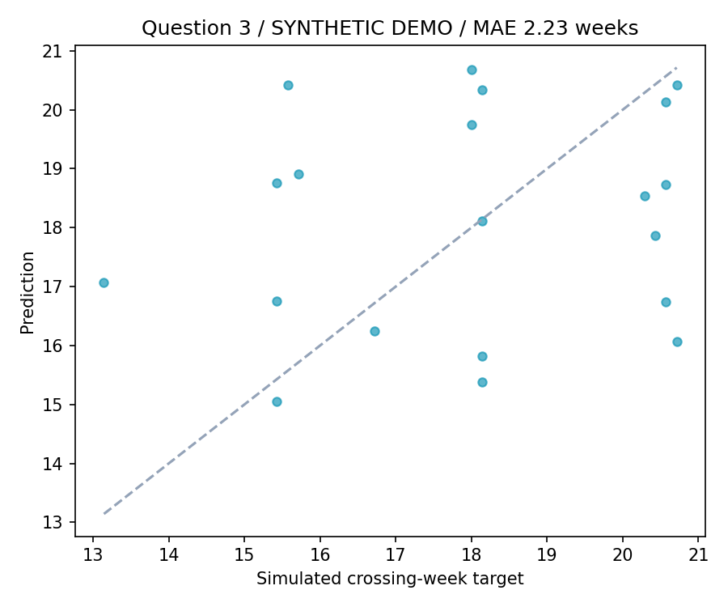

# NIPT Screening Optimization

**Repeated-measurement modeling, grouping search and machine-learning prediction for a mathematical modeling competition.**

This repository organizes questions 1-3 of a 2025 undergraduate mathematical modeling project on NIPT timing. It combines a linear mixed-effects model, a BMI grouping search and Monte Carlo targets with XGBoost regression. The included dataset is independently generated synthetic data, with no real participant records.

## Implemented questions

| Question | Research task | Method |
|---|---|---|
| 1 | Relate Y-chromosome fraction to gestational age and BMI | Descriptive summaries; patient random intercept and gestational-age random slope |
| 2 | Explore BMI grouping and timing under the source's score | Individual threshold-crossing approximation; enumeration of three/four groups |
| 3 | Predict a simulated first-observed threshold-crossing week | 100 Monte Carlo draws per patient; patient-level XGBoost regression |

Question 4 is excluded from the implemented scope. The supplied fourth-question script used randomly generated features and hand-written labels rather than the female worksheet; no real female-classification performance is claimed here. See [scope](docs/SCOPE.md).

## Run the included synthetic example

Tested with Python 3.12. From this repository's root:

```bash
python -m venv .venv
# Activate the environment using the command appropriate for your shell.
python -m pip install -r requirements.txt
python run.py --demo --out artifacts/demo
python -m unittest discover -s tests -v
```

The demo generator is `scripts/generate_demo.py`, seed 2025. It generates 100 synthetic people with repeated measurements. Demo scores are not the original competition results.



## Run on the original workbook locally

The competition workbook is not redistributed. If you have the source `附件.xlsx`:

```bash
python scripts/import_private_data.py --workbook "/path/to/附件.xlsx"
python run.py --data data/private/male.csv --out artifacts/local
```

The importer explicitly selects the male worksheet, retains only the modeled fields, and replaces source IDs while preserving group order. It does not make the resulting records suitable for public release: `data/private/` and all generated artifacts remain ignored by Git.

## Reference reconstruction

| Check | Result |
|---|---|
| Mixed-effects fit | 1,081 valid repeated records, 267 patient groups; converged with a boundary warning |
| Question 3 | 266 patients; 212 train / 54 test; MAE **1.780994 weeks** |
| Question 2 on available raw workbook | Three groups; algorithm outputs **12.00, 12.00, 16.2377 weeks** |

Question 3 matches the report's rounded 1.78-week MAE. Its target is a **simulation-derived first observed crossing**, not an independently observed continuous biological onset time.

Question 2 originally referred to a separate merged/preprocessed workbook that was not supplied. Its reconstruction therefore uses the available raw male worksheet and does not claim to reproduce all of the report's final timing numbers. These are algorithm outputs from a competition model, not clinically validated screening recommendations.

Aggregate reference results are in [results/reference](results/reference). Raw patient rows and source PDFs are deliberately not included.

## Interpretation limits

- The mixed-effects code uses both a random intercept and a gestational-age random slope; some report wording only mentions an intercept.
- Question 2 estimates individual effects using the available repeated records. It is an exploratory in-sample grouping calculation, not a prospective evaluation.
- The grouping objective rewards coverage and separation of group times with balance penalties. It does not independently implement every clinical-risk interpretation in the narrative.
- The original score's coverage condition and exported absolute-difference flag differ; both are reported rather than conflated.
- Question 3 preserves original row order when selecting the first observed threshold crossing, rather than silently changing the target definition by sorting.
- Mean predicted weeks by BMI group are model summaries, not the result of a separate risk-minimization problem. Small groups need particular caution when interpreting these summaries.

## Repository map

- `nipt/`: data validation, mixed-effects fit, grouping search, simulation and CLI.
- `data/demo/`: labelled synthetic data and its generation metadata.
- `scripts/`: original-workbook importer and synthetic-data generator.
- `results/reference/`: compact reference metrics, group counts and fit summaries.
- `docs/`: schema, source history and scope.
- `tests/`: gestational-age parsing and group-coverage boundary checks.

This was a team competition project. The supplied materials do not establish individual module-level contributions. See [provenance](docs/PROVENANCE.md) and [rights](RIGHTS.md).
